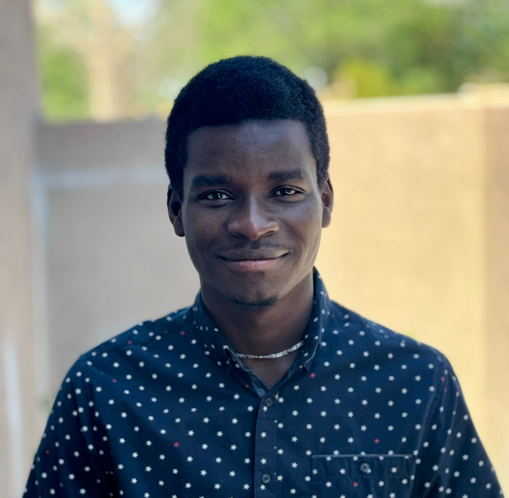
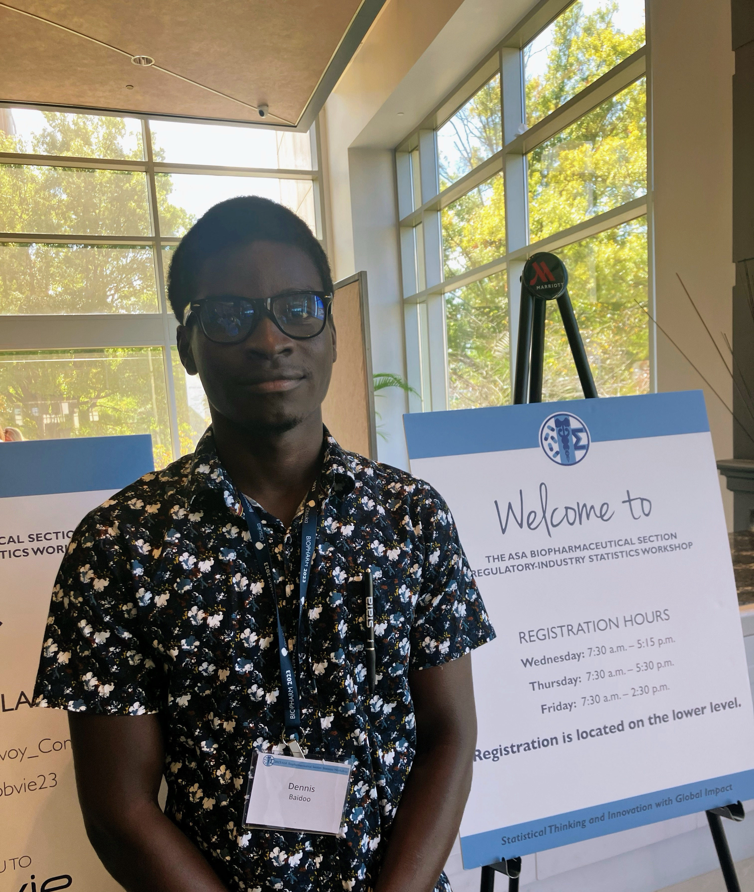

```{=html}
<section class="wrap hero">
  <div class="hero-text">
    <p class="overline">Ph.D. Student · Division of Biostatistics · College of Public Health</p>
    <h1>Dennis Baidoo, M.S., <a href="https://ww2.amstat.org/accreditation/roster.cfm" target="_blank" rel="noopener">GStat</a></h1>
    <p class="lead">I am a Ph.D. student in the <a href="https://cph.osu.edu/biostatistics" target="_blank" rel="noopener">Division of Biostatistics</a>, <a href="https://cph.osu.edu/" target="_blank" rel="noopener">College of Public Health</a>, at <a href="https://www.osu.edu/" target="_blank" rel="noopener">The Ohio State University</a>, with a background in statistics, mathematics, and data-driven approaches to scientific research.</p>
    <p class="cta"><a class="btn" href="publications.html">Research</a> <a class="btn ghost" href="cv.html">CV</a></p>
    <p class="links"><a href="https://scholar.google.com/citations?user=ffB7SWYAAAAJ&amp;hl=en&amp;oi=ao" target="_blank" rel="noopener">Google Scholar</a> <a href="https://www.researchgate.net/profile/Dennis-Baidoo-4/research" target="_blank" rel="noopener">ResearchGate</a> <a href="https://orcid.org/0009-0006-2719-7730" target="_blank" rel="noopener">ORCID</a> <a href="https://www.linkedin.com/in/dennisbaidoo1" target="_blank" rel="noopener">LinkedIn</a> <a class="mail" data-u="baidoo.20" data-d="osu.edu" href="#">Email</a></p>
  </div>
  <figure class="portrait"></figure>
</section>

<section class="wrap section" id="about">
  <div class="cols">
    <h2>About Me</h2>
    <div class="prose">
      <p>Thank you for visiting my website!</p>
      <p>I earned my M.S. in Statistics from the <a href="https://www.unm.edu/" target="_blank" rel="noopener">University of New Mexico</a> and my B.Sc. double major in Mathematics and Statistics from the <a href="https://www.ug.edu.gh/" target="_blank" rel="noopener">University of Ghana</a>. My academic journey reflects a commitment to applying statistical thinking and rigorous methodology to generate meaningful insights and support evidence-based decision-making.</p>
    </div>
  </div>
</section>

<section class="wrap section" id="news">
  <div class="section-head"><h2>Recent News</h2><a class="more" href="Awards.html">All awards and honors</a></div>
  <ul class="news">
    <li><span class="news-date">October 2026</span><span>Paper published in <em>PLOS One</em>: <a href="https://doi.org/10.1371/journal.pone.0348390" target="_blank" rel="noopener">Multi-dimensional structure and subtype-specific heterogeneity of angiogenesis in breast cancer</a>.</span></li>
    <li><span class="news-date">October 2026</span><span>Presented my paper, &ldquo;Multi-dimensional structure and subtype-specific heterogeneity of angiogenesis in breast cancer,&rdquo; at the <strong>Statistics and Biostatistics Graduate Student Poster Session</strong>, The Ohio State University.</span></li>
    <li><span class="news-date">August 2026</span><span>Won <strong>3rd Place in the Best Contributed Poster Award</strong> (Biopharmaceutical Section) at the Joint Statistical Meetings, for collaborative research with <a href="https://scholar.google.com/citations?user=bs2MgcwAAAAJ&amp;hl=en" target="_blank" rel="noopener">Robert Amevor</a> and <a href="https://emmanuelkubuafor.github.io/" target="_blank" rel="noopener">Emmanuel Kubuafor</a>.</span></li>
    <li><span class="news-date">August 2026</span><span>Selected for the <a href="https://www.amstat.org/your-career/awards/norman-beery-memorial-scholarship" target="_blank" rel="noopener"><strong>Norman Beery Memorial Scholarship</strong></a>, which supports first-generation college students in statistics, and <a href="https://magazine.amstat.org/blog/2026/06/01/2026-awards/" target="_blank" rel="noopener">featured among American Statistical Association award recipients</a>.</span></li>
    <li><span class="news-date">August 2026</span><span>Selected for the <strong>Teaching Statistical Thinking with GAISE Workshop Travel Award</strong> (NSF-funded EAPOST Program), Curry College, Milton, MA.</span></li>
    <li><span class="news-date">August 2026</span><span>Started the Interdisciplinary Ph.D. in Biostatistics at The Ohio State University, supported by a <strong>University Fellowship</strong>.</span></li>
    <li class="news-extra"><span class="news-date">June 2026</span><span>Received the <strong>NISS Writing Workshop for Junior Researchers Travel Award</strong> from the National Institute of Statistical Sciences.</span></li>
    <li class="news-extra"><span class="news-date">Fall 2025</span><span>Featured in the <a href="https://www.amstat.org/docs/default-source/amstat-documents/ASAGiving-NewsletterFall2025.pdf" target="_blank" rel="noopener">American Statistical Association Giving Newsletter</a>, sharing my experience at the 2025 Joint Statistical Meetings and the impact of the American Statistical Association Student and Early Career Travel Fund.</span></li>
    <li class="news-extra"><span class="news-date">August 2025</span><span>Received the <strong>Lester R. Curtin Award</strong> from the American Statistical Association and <a href="https://magazine.amstat.org/blog/2025/06/02/awardees/" target="_blank" rel="noopener">featured among American Statistical Association award recipients</a>.</span></li>
    <li class="news-extra"><span class="news-date">June 2025</span><span>Received the <a href="https://stat4pharma.org/events/sip2025/scholarship.html" target="_blank" rel="noopener"><strong>Statistics in Pharmaceuticals (SIP) Scholarship Award</strong></a>, University of Connecticut.</span></li>
    <li class="news-extra"><span class="news-date">May 2025</span><span>Elected a member of <strong>Sigma Xi</strong>, University of New Mexico Chapter, in recognition of excellence in scientific research.</span></li>
    <li class="news-extra"><span class="news-date">April 2025</span><span>Honored by the University of New Mexico with the <strong>Excellence in Teaching Award</strong> and <strong>Student of the Year</strong> (<a href="https://www.instagram.com/unmafro/p/DJKe6LWvQJe/" target="_blank" rel="noopener">UNM recognition</a>).</span></li>
    <li class="news-extra"><span class="news-date">August 2024</span><span>Received the <strong>American Statistical Association Biopharmaceutical Section Student Scholarship Award</strong> as the sole master&rsquo;s student among the recipients (<a href="https://asabiopreport.substack.com/p/transition-report" target="_blank" rel="noopener">American Statistical Association Biopharmaceutical Section report</a>).</span></li>
    <li class="news-extra"><span class="news-date">May 2024</span><span>Began the <a href="https://research.unm.edu/zancada/" target="_blank" rel="noopener"><strong>Zancada Graduate Fellowship</strong></a>, University of New Mexico Office of the Vice President for Research.</span></li>
    <li class="news-extra"><span class="news-date">April 2024</span><span>Inducted into the <strong>Golden Key International Honour Society</strong>, recognizing the top 15% of the graduating class.</span></li>
    <li class="news-extra"><span class="news-date">2024</span><span>Earned <a href="https://ww2.amstat.org/accreditation/roster.cfm" target="_blank" rel="noopener">Graduate Statistician (GStat)</a> accreditation from the American Statistical Association.</span></li>
  </ul>
</section>

<section class="wrap section" id="areas">
  <div class="section-head"><h2>Research areas</h2><a class="more" href="publications.html">All papers</a></div>
  <div class="area-rows">
    <a class="area-row" href="publications.html"><span class="num">01</span><span class="area-title">Cancer Survival and Genomics</span><span class="area-text">Survival modeling and molecular subtypes in breast and lung cancer, including angiogenesis and KRAS mutation profiles.</span></a>
    <a class="area-row" href="publications.html"><span class="num">02</span><span class="area-title">Clinical Trials and Treatment Surveillance</span><span class="area-text">Adaptive Phase I dose-finding designs and Bayesian surveillance of treatments.</span></a>
    <a class="area-row" href="publications.html"><span class="num">03</span><span class="area-title">Spatial and Population Health</span><span class="area-text">Spatial patterns of cancer mortality and disease, and community-level determinants of health.</span></a>
    <a class="area-row" href="publications.html"><span class="num">04</span><span class="area-title">Forecasting Health Trends</span><span class="area-text">Time series models for lung cancer mortality and malaria trends.</span></a>
  </div>
</section>

<section class="wrap section" id="journey">
  <div class="cols">
    <h2>My Academic Journey</h2>
    <div class="entries">
<article class="entry"><div class="entry-date">Aug 2026 – May 2031</div><div class="entry-body"><h4>Interdisciplinary Ph.D. in Biostatistics</h4><p class="meta">Division of Biostatistics, College of Public Health, The Ohio State University</p></div></article>
<article class="entry"><div class="entry-date">Jan 2023 – May 2025</div><div class="entry-body"><h4>M.S. in Statistics</h4><p class="meta">University of New Mexico</p></div></article>
<article class="entry"><div class="entry-date">Aug 2017 – Nov 2021</div><div class="entry-body"><h4>B.Sc. in Mathematics &amp; Statistics</h4><p class="meta">University of Ghana, Legon</p></div></article>
    </div>
  </div>
</section>

<section class="wrap section" id="beyond">
  <div class="cols">
    <h2>Beyond Research</h2>
    <div class="beyond">
      <div>
        <p>Outside of my research, I engage in professional service through American Statistical Association and ENAR initiatives, support underrepresented high school and college students, enjoy connecting with nature, cooking authentic Ghanaian cuisine, participating in football, and pursuing hands-on craftsmanship, including making leather sandals and building wooden furniture.</p>
        <p class="spirit">GO BUCKS AND V-MATE, SHARP!</p>
      </div>
      <figure class="photo"><figcaption>Registration Assistant at the 2023 American Statistical Association Biopharmaceutical Section Regulatory-Industry Statistics Workshop, Rockville, MD</figcaption></figure>
    </div>
  </div>
</section>
```
