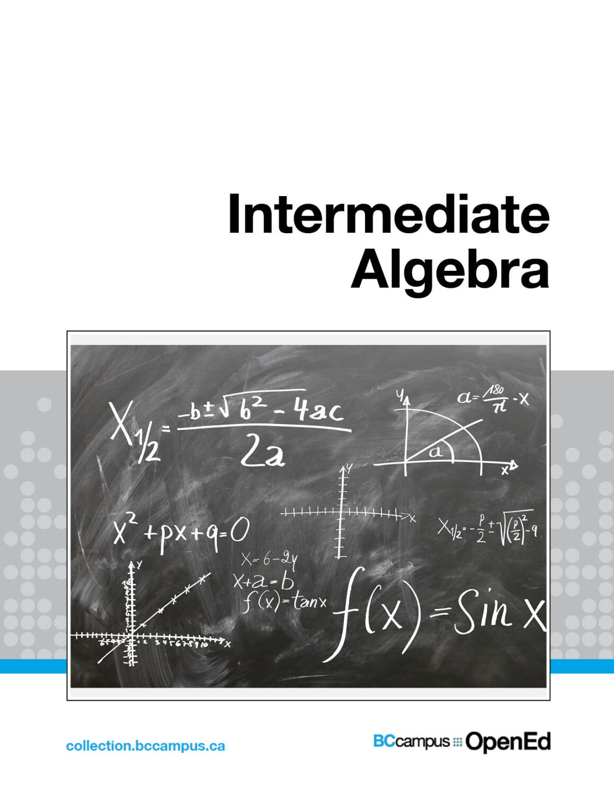
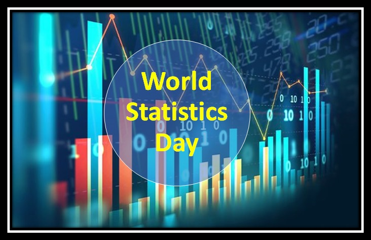
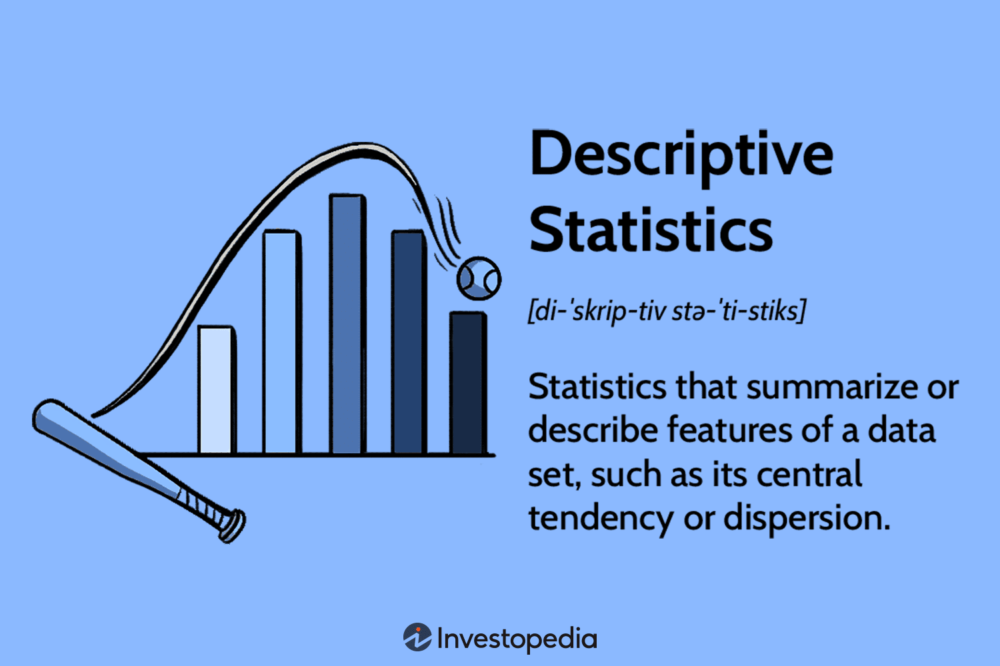
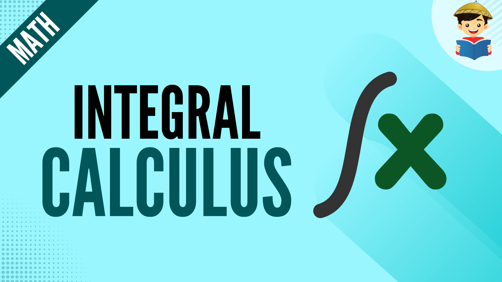
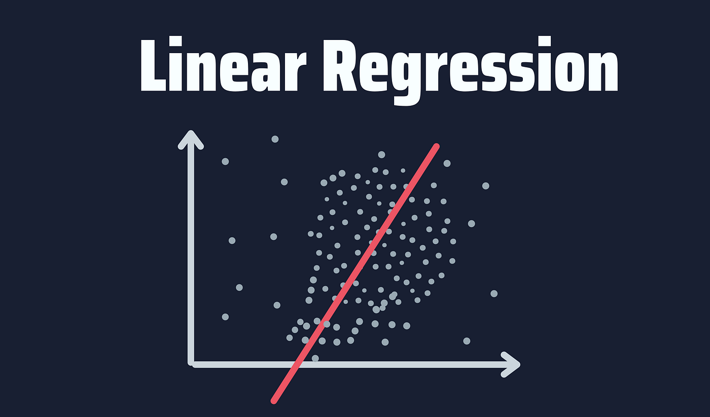

```{=html}
<section class="wrap page-head">
<p class="overline">Teaching</p>
<h1>Teaching</h1>
<p class="lead">I have served as an instructor and teaching assistant for the following courses.</p>

</section>
<section class="wrap page-body">
<article class="deck"><div class="deck-thumb"></div><div><h2>MATH 1215: Intermediate Algebra</h2><div class="terms"><a href="https://math.unm.edu/courses/materials/math-1215-intermediate-algebra" target="_blank" rel="noopener">Spring 2026</a></div><p>Instructor, University of New Mexico, Department of Mathematics and Statistics - 36 students.</p></div></article>
<article class="deck"><div class="deck-thumb"></div><div><h2>MATH 1350: Introduction to Statistics</h2><div class="terms"><a href="https://catalog.unm.edu/catalogs/2021-2022/courses/MATH/1350.html" target="_blank" rel="noopener">Spring 2023</a><a href="https://catalog.unm.edu/catalogs/2021-2022/courses/MATH/1350.html" target="_blank" rel="noopener">Fall 2023</a><a href="https://catalog.unm.edu/catalogs/2021-2022/courses/MATH/1350.html" target="_blank" rel="noopener">Spring 2024</a><a href="https://catalog.unm.edu/catalogs/2021-2022/courses/MATH/1350.html" target="_blank" rel="noopener">Summer 2024</a><a href="https://catalog.unm.edu/catalogs/2021-2022/courses/MATH/1350.html" target="_blank" rel="noopener">Spring 2025</a><a href="https://catalog.unm.edu/catalogs/2021-2022/courses/MATH/1350.html" target="_blank" rel="noopener">Summer 2025</a><a href="https://catalog.unm.edu/catalogs/2021-2022/courses/MATH/1350.html" target="_blank" rel="noopener">Fall 2025</a></div><p>Instructor, University of New Mexico, Department of Mathematics and Statistics - 500+ students.</p></div></article>
<article class="deck"><div class="deck-thumb"></div><div><h2>MATH 1300: Statistical Literacy</h2><div class="terms"><a href="https://catalog.unm.edu/catalogs/2021-2022/courses/MATH/1300.html" target="_blank" rel="noopener">Fall 2024</a></div><p>Instructor, University of New Mexico, Department of Mathematics and Statistics - 43 students.</p></div></article>
<article class="deck"><div class="deck-thumb"></div><div><h2>MATH 1512, 1522, &amp; 2531: Calculus I, II, &amp; III</h2><div class="terms"><a href="https://catalog.unm.edu/catalogs/2021-2022/courses/MATH/index.html" target="_blank" rel="noopener">Summer 2023</a><a href="https://catalog.unm.edu/catalogs/2021-2022/courses/MATH/index.html" target="_blank" rel="noopener">Spring 2025</a></div><p>Instructor, University of New Mexico, African American Student Services - 35 students.</p></div></article>
<article class="deck"><div class="deck-thumb"></div><div><h2>MATH 1350: Introduction to Statistics</h2><div class="terms"><a href="https://24-25-enmur.catalog.prod.coursedog.com/courses/MATH1350" target="_blank" rel="noopener">Summer 2023</a></div><p>Instructor, Eastern New Mexico University, Department of Nursing - 5 students.</p></div></article>
<article class="deck"><div class="deck-thumb"></div><div><h2>STAT 445: Regression Analysis</h2><div class="terms"><a href="https://balme.ug.edu.gh/past.exampapers/index.php?p=show_detail&id=7855&keywords=STAT+445" target="_blank" rel="noopener">Fall 2021</a></div><p>Teaching Assistant, University of Ghana, Department of Statistics and Actuarial Science - 84 students.</p></div></article>
</section>
```
